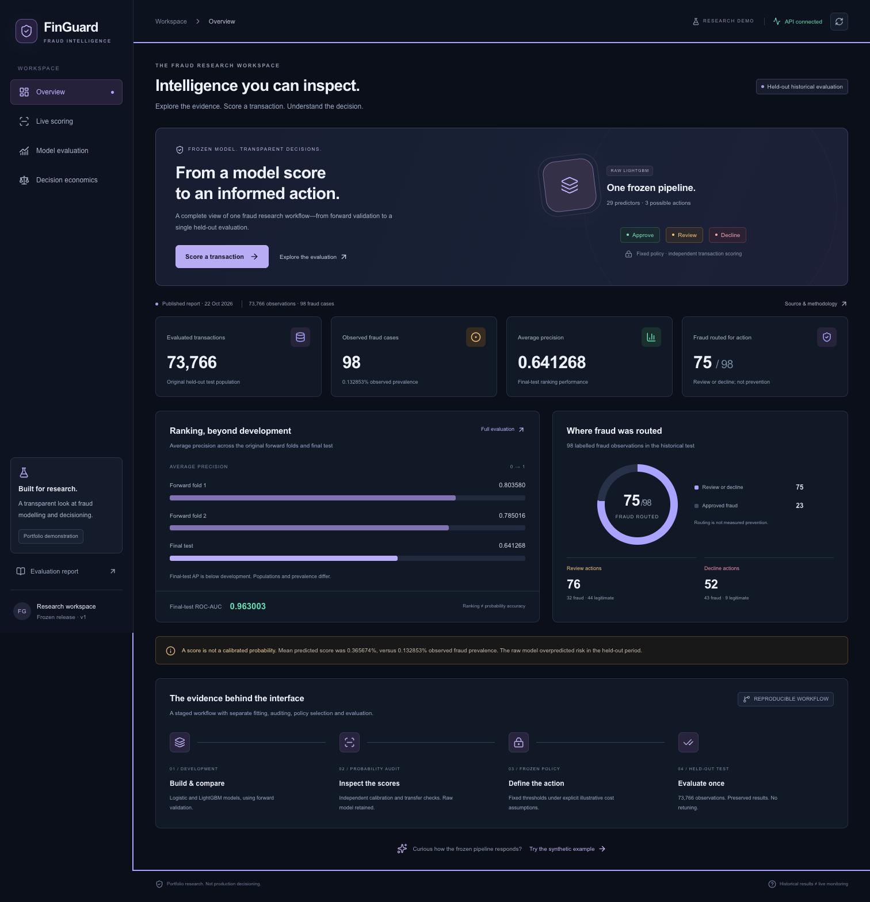
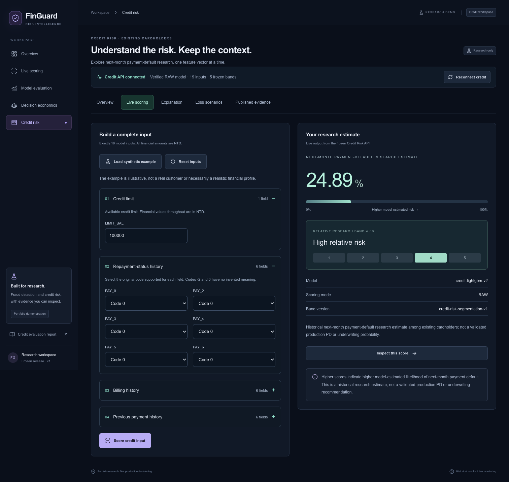
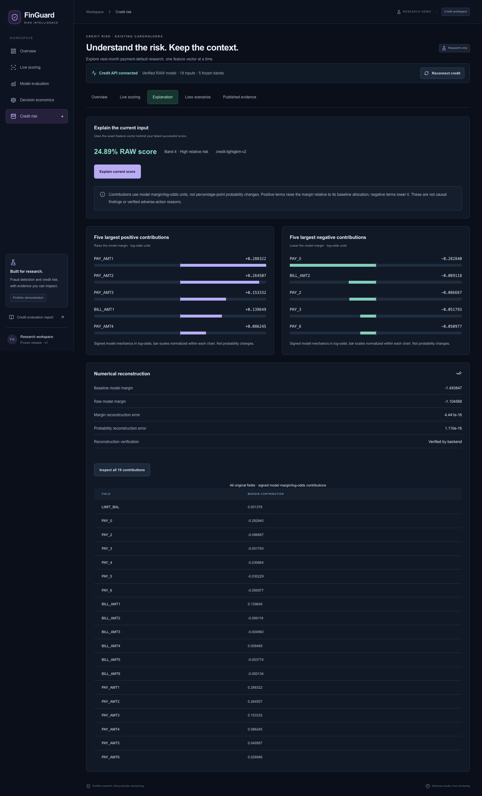
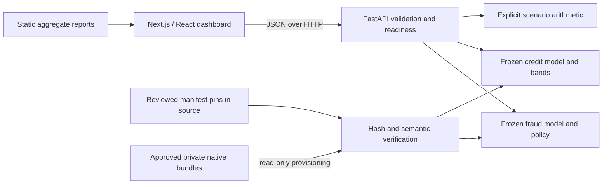

# FinGuard

A portfolio research application for inspecting fraud detection, credit risk and the decisions built around model scores. A Next.js dashboard connects to a FastAPI backend that serves two frozen LightGBM models with verified, separately versioned inference contracts.

**Published source:** [RyhanKhan/finguard](https://github.com/RyhanKhan/finguard). The interactive cloud demo is not deployed yet. A project software license has not been selected. **This source alone cannot perform live model inference: approved private model bundles are required and are not distributed here.** Static historical results and screenshots can be explored without models; missing models produce explicit unavailable states, never simulated predictions.

## Fraud Detection

- Score one complete transaction vector: `V1`–`V28` and `Amount`.
- Inspect a RAW model estimate and frozen approve/review/decline policy reasoning.
- Review published historical ranking, routing and illustrative decision-cost results.
- Preserve exact thresholds and equality rules; no automatic fitting, recalibration or policy optimization.

## Credit Risk

- Score 19 financial/repayment inputs for existing-cardholder default research.
- Inspect five frozen relative-risk bands and native feature contributions in model-margin/log-odds units.
- Verify that contributions reconstruct the model margin and probability.
- Reject unsupported repayment codes, including `PAY_4=1`, instead of guessing an encoding.
- Calculate hypothetical `PD × LGD × EAD` separately, with explicit assumptions in NTD.

No credit approval/denial or regulated credit grade is produced. Fraud policy reasoning is not individual feature attribution.

## Historical results

Previously published, frozen evaluation aggregates; these are not live production measurements or newly rerun evaluations.

| Metric | Fraud | Credit, supported population |
| --- | ---: | ---: |
| Evaluated observations | 73,766 | 6,000 of 6,001 original |
| Positive outcomes | 98 | 1,274 |
| Average precision | 0.641268 | 0.534170 |
| ROC-AUC | 0.963003 | 0.775807 |
| Brier score | 0.001030958 | 0.132728 |
| Log loss | 0.007075619 | 0.424144 |

One credit observation was unscorable; full-original-population performance is unavailable. Raw scores are not validated production probabilities. Read the aggregate [fraud report](docs/fraud_final_evaluation.md) and [credit report](docs/credit_final_evaluation.md) for scope and limitations.

## Screenshots

Captured from local research demonstrations using invented scoring inputs or approved aggregate results. They are not an operational monitoring feed.





All 14 approved desktop/mobile images are listed in the [screenshot review](release/screenshots.json).

## Architecture and stack



Python 3.12; Node.js 24; Next.js 16.4.2, React 19.3.1 and TypeScript; FastAPI 0.135.0 / Starlette 1.3.1 and Pydantic 2.11.5; LightGBM 4.6.0, NumPy 2.2.6, SciPy 1.14.1 and pandas 2.2.3. Exact dependencies remain in the runtime/test locks and `frontend/package-lock.json`. See [portable architecture](docs/portable_release.md).

## Local setup

From this source root, with Python 3.12 and Node 24 selected:

```sh
python3.12 -m venv .venv
.venv/bin/python -m pip install -r requirements-test-lock.txt
.venv/bin/python -m pip install --no-deps --no-build-isolation .
.venv/bin/python -m pip check
```

For approved model holders, set `FINGUARD_INFERENCE_ROOT` to the external portable-model root, then:

```sh
PYTHONDONTWRITEBYTECODE=1 OMP_NUM_THREADS=1 OPENBLAS_NUM_THREADS=1 \
  .venv/bin/python -m backend.app.launch
```

Without models, the same command starts a live service with unavailable model readiness; static pages and explicit scenario arithmetic remain usable. No model downloads are automatic.

In another terminal:

```sh
cd frontend
npm ci
NEXT_TELEMETRY_DISABLED=1 npm run build
NEXT_TELEMETRY_DISABLED=1 npm start
```

Open http://127.0.0.1:3000. The API defaults to http://127.0.0.1:8000. Set `NEXT_PUBLIC_API_BASE_URL` before building to change it; this value is public. Safe examples are in `.env.example` and `frontend/.env.example`; the backend reads process environment variables, not dotenv files automatically. Follow [local startup](docs/local_startup.md) for OpenMP, readiness and external model provisioning.

## Docker backend

Build and run locally for the verified target:

```sh
docker build --platform linux/amd64 -t finguard-backend:local .
# Set this to an external, approved model root; never use a research-bundle root.
export FINGUARD_INFERENCE_ROOT='/path/to/approved/private/portable-models'
docker run --rm --platform linux/amd64 --read-only \
  --tmpfs /tmp:rw,nosuid,size=64m --cap-drop ALL \
  --security-opt no-new-privileges=true -p 127.0.0.1:8000:8000 \
  --mount "type=bind,source=$FINGUARD_INFERENCE_ROOT,target=/models,readonly" \
  finguard-backend:local
```

The pinned image contains serving source/dependencies only. It runs as UID/GID 10001; mounted files must be readable by that non-root account. [Docker instructions](docs/docker.md) explain exact validation scope and readiness. No image/model publication is authorized.

## Model artifact requirements

```text
external-approved-model-root/
  fraud-inference-v1/   manifest.json model.txt contract.json policy.json
  credit-inference-v1/  manifest.json model.txt contract.json bands.json
```

The source catalog authenticates reviewed manifests; payload hashes, sizes, strict schemas, runtime versions and frozen model semantics are checked before native parsing. SHA-256 identities are nonsecret integrity/provenance references, not bundled model bytes or access credentials. Do not upload arbitrary serialized models, change pins to bypass verification or copy original research bundles. See [distribution and attribution](docs/model_distribution.md).

## Testing and verification

```sh
.venv/bin/python -B scripts/audit_public_source.py
# In a later authorized Git checkout, add --allow-git (source-only audit; history not assessed).
.venv/bin/python -B -m pytest -q
# Requires both verified bundles and a running API:
.venv/bin/python -B -m backend.smoke_test
cd frontend
npm run typecheck
npm run lint
npm run format:check
npm test
npm run build
# Requires a running frontend/API and an installed Playwright browser:
npm run test:e2e
```

Model-dependent Python tests explicitly skip when `FINGUARD_INFERENCE_ROOT` is unset. They are not reported as passed without actual models. Test corruption copies and generated outputs belong in a private test temp directory, never public source. The browser journeys use actual inference for ordinary scoring, with explicitly labelled readiness-fault interception. See [validation](docs/validation.md) for historical and current results and [dependency review](docs/dependency_security.md) for known issues. Functional tests do not imply vulnerability clearance.

## Research limitations

Fraud is a historical, imbalanced transaction task with temporal dependence, upstream PCA uncertainty and only 98 final-test positives. Credit results apply to the supported historical population and are not chronological or borrower-independent validation. Ranking does not establish calibration; risk bands are relative research segments. Native contributions describe model mechanics, not causes or legally sufficient adverse-action reasons. Hypothetical losses/costs are not realized savings. No fairness, regulatory, production security, latency or capacity certification is claimed. Use invented inputs for this demonstration.

## Portfolio launch handoff

The backend launcher supports the platform PORT, exact production Host/CORS, bounded requests and optional fixed-name private Render secret files. Vercel builds require an explicit HTTPS `NEXT_PUBLIC_API_BASE_URL` and reject loopback/default-local configuration. See [deployment instructions](docs/deployment_handoff.md) and the [A/B/C owner checklist](docs/publication_plan.md). No cloud deployment or model upload has occurred. Root LICENSE selection is optional.

## Distribution and license notes

No root `LICENSE` has been selected. This candidate must not be described as open-source licensed until the owner authorizes a license and authorship review. Dataset attribution is in [ATTRIBUTION.md](ATTRIBUTION.md); dependency obligations are in [THIRD_PARTY_NOTICES.md](THIRD_PARTY_NOTICES.md). Both trained bundles remain outside Git. Credit has a published CC BY 4.0 licensing basis with attribution/provenance checks; the specific fraud hosting obligations remain unresolved. A live credit plus static fraud portfolio is an available alternative. See the [component status matrix](docs/model_distribution.md), [publication plan](docs/publication_plan.md) and [cloud handoff](docs/deployment_handoff.md). No GitHub or deployment URL is invented here.
